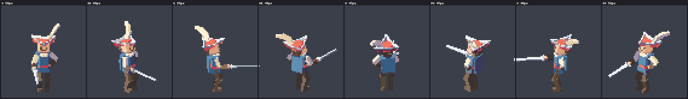
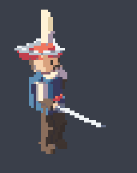
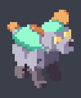
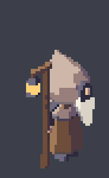

# charkit — 3D pixel-art characters, made by coding agents

A small, self-contained kit for making animated characters in the **"3D pixel art"** style of t3ssel8r and David
Holland: low-poly 3D models drawn through an orthographic, texel-snapped camera at 640×360, banded toon light,
1-pixel inner lines, and poses held on a 30 Hz grid like hand-drawn sprites. A character is **one JavaScript file of
plain data** (skeleton, parts, palette, clips) that a coding agent writes; the kit renders it headless and measures
it, so the agent can see its work and iterate.

It is extracted from a larger renderer project in which a swarm of agents built about 30 characters through an
author → critic → refine loop with a 24-point rubric. Everything they learned the hard way is in `LEARNINGS.md`, and
the process is in `AGENTS.md`.

| | | |
|---|---|---|
|  | | |
|  |  |  |
| duelist: lunge (×4) | hound: walk (×4) | keeper: raising the lantern (×4) |

`examples/` also holds a 1× real-time crossing at game speed (`duelist-game-1x.gif` — this is how the pipeline judges
readability) and a sample `report.txt`.

## What you get

- **The character runtime** (`src/chars/`): rig + body-plan templates (biped, chibi/upright animal, quadruped, bird,
  hopper, limbless, flier, long neck), a kit of low-poly shapes, keyed clips on a 30 Hz grid, procedural gaits with
  foot planting, second-order dynamics for capes/tails/ears, smears and stepped FX (speech bubbles, sparkles, dust),
  and the character material. Plus the minimal renderer core it needs (`src/core`, `src/materials`, `src/post`,
  `src/world` for the test meadow).
- **The pack tool** `tools/charpack.sh <id>`: renders a turnaround at 8 facings, contact strips and GIFs for every clip
  (×4 and 1× real-time), the walk at your game's speed over a tiled floor, the character in a meadow at noon / golden
  hour / night, and ~100 automated checks (`report.txt`: pixel stability, off-grid motion, foot slide, readability at
  game speed, palette discipline, ground contrast, …).
- **Sprite-sheet baking** for 2D games: `tools/charpack.sh --bake <id>` → PNG atlas + JSON (8 directions, holds, anchor).
- **Exemplars**: `characters/duelist`, `keeper`, `hound` (with design sheets) and `mannequin` (the bare base biped).
- **For agents**: `AGENTS.md` (process, rubric, what every check means, game-speed calibration), `LEARNINGS.md`,
  a brief template (`characters/_TEMPLATE.md` + `_template.js`), and a multi-agent workflow
  (`workflows/character.workflow.js`).

## Requirements

- Node.js 18+ (20 or 22 recommended) and npm
- Python 3.8+ with Pillow and numpy (`requirements.txt`)
- Playwright's Chromium (installed below; ~150 MB). On Linux it may need system libraries: `npx playwright install-deps chromium`.
- A GPU is optional. With one (NVIDIA/AMD/Intel on Linux via Vulkan, Apple GPUs via Metal, Windows via D3D11) a full
  pack takes ~40–75 s. Without one, Chromium falls back to SwiftShader software rendering: nearly the same pixels (a few
  shading/speckle pixels differ, and `night_pan` can FAIL by ~5 px), slower — on a 32-core box a full pack took 44 s at
  `--jobs 4` vs 38 s on an RTX 4090; expect several minutes on a laptop. Compare packs only from the same backend. Rendering happens on your machine; nothing is uploaded anywhere.
- macOS, Linux or WSL2 (the tools are bash scripts).

## Quickstart (5 minutes)

```sh
npm install                                   # three.js + playwright
npx playwright install chromium               # the headless browser
python3 -m pip install -r requirements.txt    # Pillow + numpy (or inside a venv)
tools/doctor.sh                               # checks everything, renders one still, prints the GPU in use

tools/charpack.sh duelist                     # full pack of an exemplar (~40 s on a GPU)
```

Then open the outputs in `shots/char-duelist/`:
- `turnaround.png` — the 8 facings, `turnaround-silhouette.png` — silhouettes + 25 % thumbnails
- `clip-lunge.png` (contact strip, `f<grid frame> x<hold>`), `clip-lunge.gif` (×4), `clip-lunge-1x.gif` (1× real time)
- `game-1x.gif` / `game-x3.gif` — the walk at game speed over 1 m tiles; `scene-golden-crop.png` — in the meadow
- `report.txt` — every check with PASS / WARN / FAIL (the exemplars predate some checks: on their legacy gait
  `game.readable` FAILs for all three and the hound also FAILs `game/run.foot_slide` — `AGENTS.md` §7 explains each row)

Make your own:

```sh
tools/new-character.sh lamplighter "Lamplighter" "Lights the lamps at dusk; long pole, sooty coat."
tools/charpack.sh lamplighter --only turnaround     # look at shots/char-lamplighter/turnaround.png
tools/charpack.sh lamplighter --preset profile      # all the clips in game-profile.json
```

Or hand it to an agent: *"Read AGENTS.md and make a character: id lamplighter, brief '…'."*
In Claude Code with the Workflow tool, `workflows/character.workflow.js` runs author → critic → refine → final critic.

## Fit it to your game

`game-profile.json` holds the two things that are specific to a game:
- **the clip set** every character needs (ours: idle, walk, talk, vote, point, die, ghost, ghost-spent + one emote), and
- **the game speed** relative to body size (ours: 3.95 body-heights per second, a 4-drawing walk at 12.5 fps).

`python3 tools/gamespeed.py --sprite-px <height> --speed-px <px/s> --drawings <n> --fps <fps>` computes the speed block
from your game's numbers. See `AGENTS.md` §5 and §6.

## Layout

```
AGENTS.md  CLAUDE.md  LEARNINGS.md  README.md   agent entry point, Claude Code pointer, lessons, this file
game-profile.json                               your game's clip set and speed
characters/   _TEMPLATE.md _template.js         brief/design-sheet + spec templates (tools/new-character.sh)
              mannequin duelist keeper hound    exemplar specs (.js) and design sheets (.md)
src/chars/    rig kit look anim dynamics ik locomotion character smear fx spike index   the character runtime
src/core src/materials src/post src/world       renderer core + the meadow used for scene shots
scenes/       char-stage.js (look-dev/check stage, URL options in its header)  char-bake.js (sprite sheets)
index.html src/main.js                          page entry (scene=<name>)
tools/        charpack.sh charkit_pack.py charpack.py charcheck.py bake.py   pack, checks, sprite bake
              shot.sh shot.mjs remote.sh pull.sh clean.sh doctor.sh new-character.sh gamespeed.py sheet.py charexports.mjs
workflows/    character.workflow.js             author → critic → refine (multi-agent)
docs/         CHARACTERS.md (spec contract)  CHARACTER_PLAYBOOK.md  CHARACTER_TECHNIQUES.md  PIPELINE.md (engine)
examples/     GIFs/PNGs above + a sample report.txt
shots/  out/                                    your renders / sprite sheets (git-ignored)
```

## Optional: render on another machine

Set `PIXEL3D_HOST=<ssh alias>` and the tools rsync the kit to `<alias>:~/charkit/` (change with `PIXEL3D_RDIR`), render
there and copy the results back. The remote needs the same requirements; `PIXEL3D_ENV=<file>` is sourced there first
(e.g. to put Node on PATH). Unset or `local` = render here.

## Troubleshooting

- `tools/doctor.sh` fails on the test render: try `PIXEL3D_GL=swiftshader tools/doctor.sh`. If that works, your GPU
  backend is the problem; try `PIXEL3D_GL=gl` (Linux) or leave software rendering on and use `--jobs 2`.
- `Executable doesn't exist` from Playwright: `npx playwright install chromium` (same Playwright version as package.json).
- Linux: missing `libnss3`, `libgbm` …: `npx playwright install-deps chromium` (needs sudo) or your distro's packages.
- Every output is regenerated per run; clear old ones with `tools/clean.sh shots/char-<id>` or use `--out` with a new folder.
- `turnaround-isolated.png` shows magenta pixels: that is the debug marker for stray (isolated) pixels on the
  signature part, not a palette colour.

## Credits

Built on [three.js](https://threejs.org) (MIT) and [Playwright](https://playwright.dev) (Apache-2.0), installed by npm.
The look follows the public talks and posts of t3ssel8r and David Holland's write-up on 3D pixel art rendering; no
assets of theirs are included.
