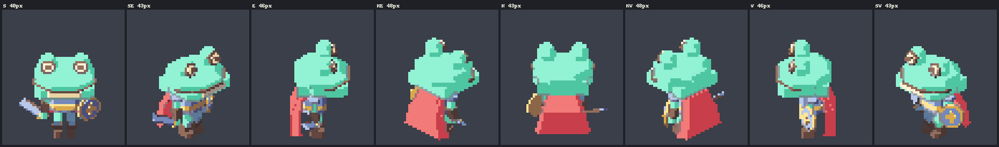
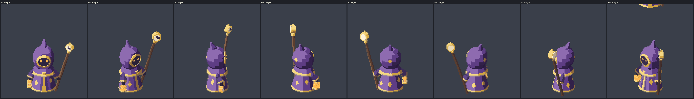

# Town pipeline

This is the agent pipeline that built **Hollowmere**, the 3D pixel-art town of Clocktower v3. Hand this folder to a
coding agent (Claude Code or similar) to build or extend t3ssel8r-style scenery on the pixel3d engine in
`../pixel3d/`: buildings, interiors, foliage, ground, props, ambient animation and a walkable demo.

**Agents: start with [AGENTS.md](AGENTS.md).** It covers prerequisites, how to render and look at the results, the
golden rules, and step-by-step recipes. [PROCESS.md](PROCESS.md) explains the multi-agent process and the lessons
learned. `workflows/` holds parameterised orchestration scripts. `templates/` holds copy-paste briefs.

## What it produced

- **The town.** A ring of 15 cottages, each with its own architecture: a stargazer's tower, a toadstool, a giant boot,
  a treehouse oak, an upturned-boat roof, a water mill and more. They stand round a circular square with a voting
  circle and a Storyteller's dais, under a gothic clock tower, with a spring forest rim, a river and a bridge.
  - Every building, tree and prop is deterministic three.js code: 640x360 internal resolution, an orthographic
    texel-snapped camera, 1-px outlines with cream rims, 3-band toon light, sprite grass and leaf canopies.
  - Five times of day (noon, morning, afternoon, golden, night). Golden hour sends the tower's shadow across the
    circle; at night windows glow and lamps throw dithered pools.
  - A camera-aware cut-away keeps the circle, the player and the cottage the player is facing visible.
  - Two quality tiers: the low tier is about 0.36M triangles at the square.
- **Life.** Stepped door swings, chimney smoke, crows, cats, townsfolk walking the lanes, the clock striking, and a
  voting ceremony on the dais.
- **Interiors.** 15 enterable "dollhouse" rooms. Each has its own shape, light recipe, animated ambiance and story
  props that hint at a shared lore.
- **The demo.** Walk the town as any finished character, enter the houses, and drive the clock, phases, seats,
  quality tier and camera from a panel. It ships as a self-contained static bundle (about 5 MB, 162 files) that runs
  under a strict `script-src 'self'` CSP from any sub-path.

The final render list, bench tables, verified user requests and honest known flaws are in
[../pixel3d/docs/TOWN_GALLERY.md](../pixel3d/docs/TOWN_GALLERY.md). Town renders are not checked in (regenerate them
with `tools/townshots.sh`; see AGENTS.md §3). The rendered cast that walks the town is in
[../gallery/](../gallery/README.md):

## How it was built (one paragraph)

1. A foundation lead wrote the contract (`docs/TOWN.md`), a building kit and a stub for every piece, so the town
   rendered from the first minute.
2. One agent per piece authored its building; an independent art-director critic scored it against a 12-criterion
   rubric, and the author refined it.
3. The lead integrated the pieces. Two critics then reviewed the whole town and routed issues to owners, who fixed
   them in parallel.
4. Every user request went into the contract and was checked by an independent verifier, for up to 3 rounds.
5. The same pattern then built the demo: contract and stubs first, then owners, a performance fleet, playtesters, a
   CSP-verified bundle, and continuous release.

All rendering happened headless on a separate GPU render host. The editing machine only edited files.
